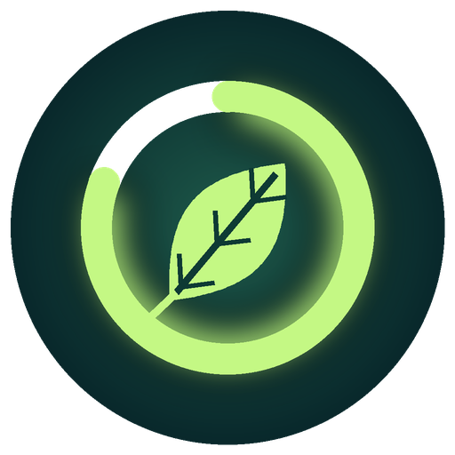
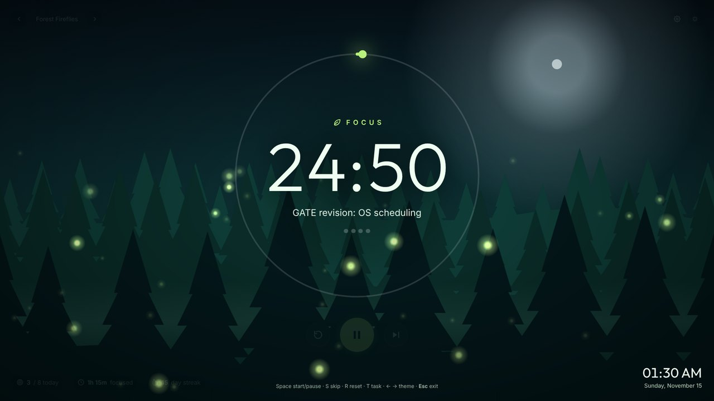
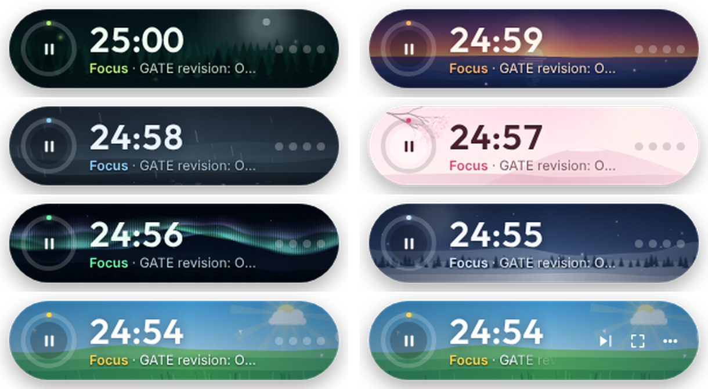
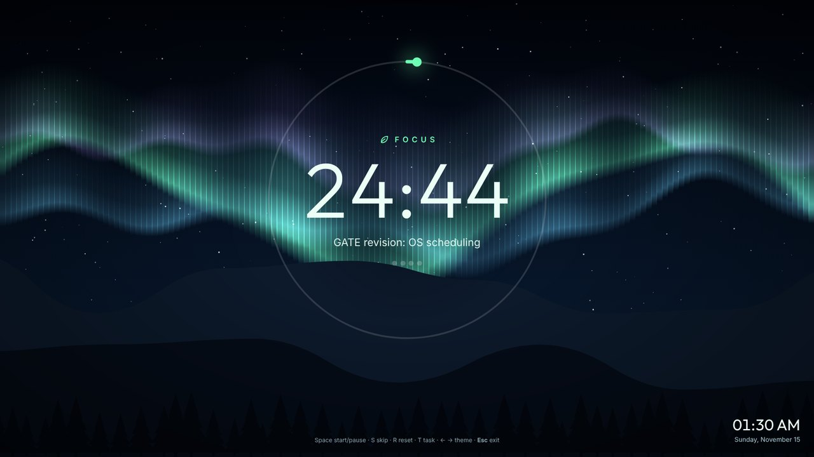
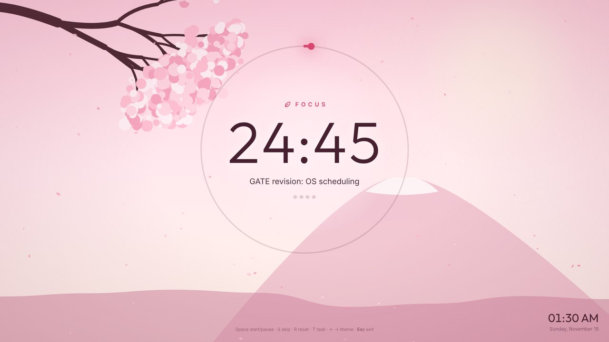
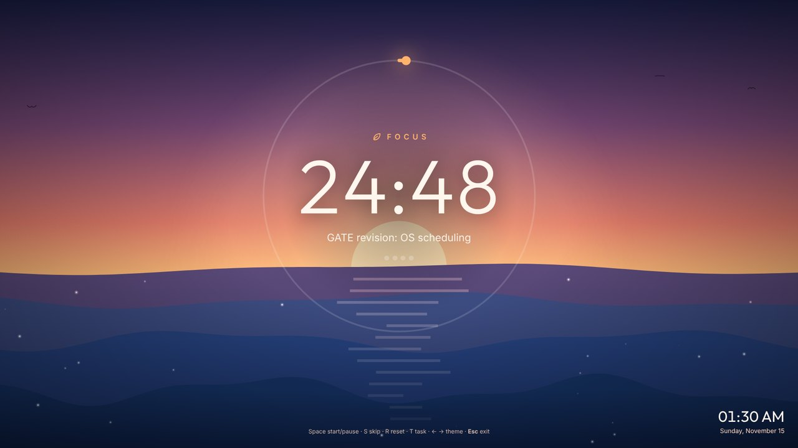
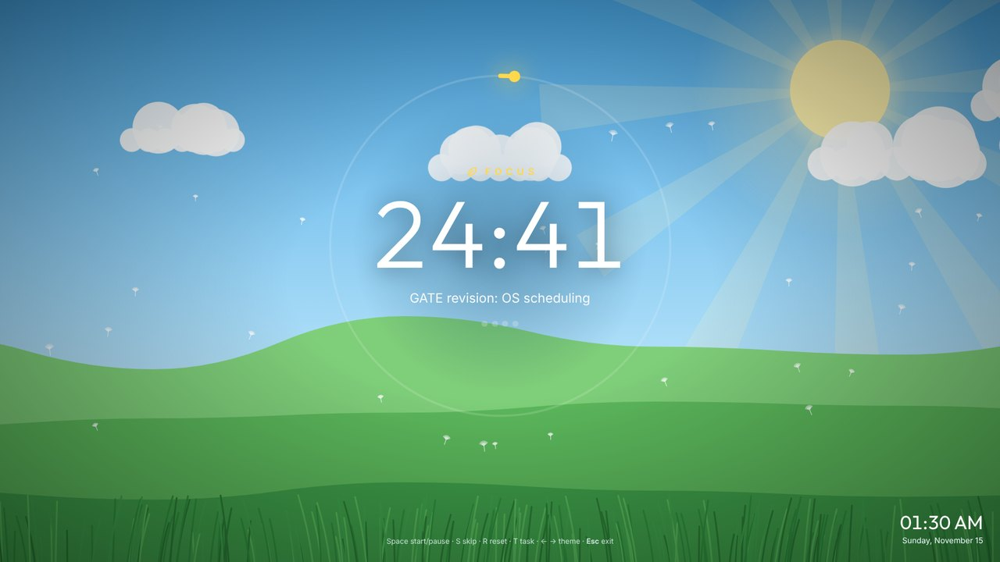
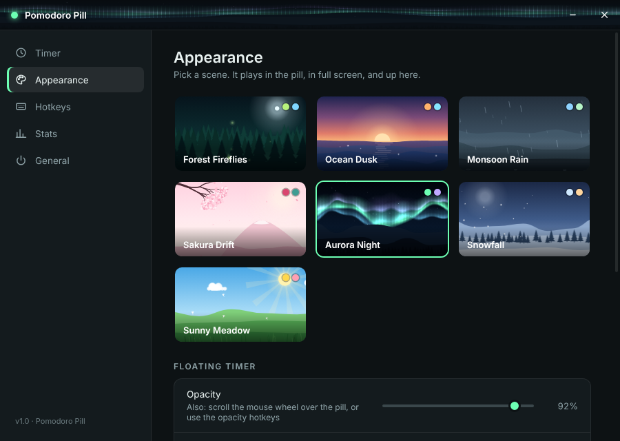
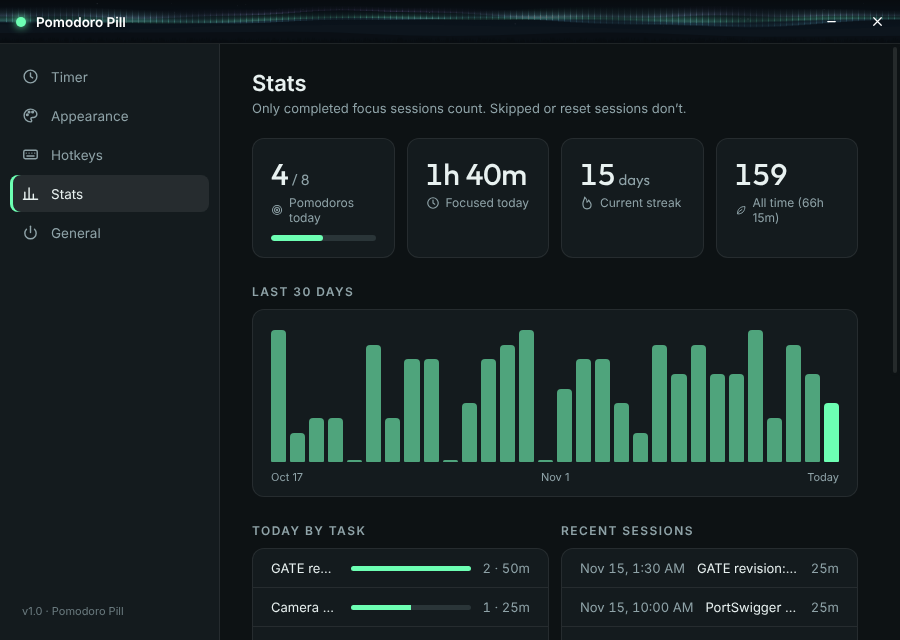

<p align="center">
  
</p>

<h1 align="center">Pomodoro Pill</h1>

<p align="center">
  An always-on-top Pomodoro timer for Windows 11, with adjustable opacity, a true full-screen focus mode and seven animated nature themes.
</p>

<p align="center">
  <a href="https://github.com/rhlxch/pomodoro-pill/releases/latest"><b>⬇ Download for Windows</b></a>
</p>



## Features

**A floating pill that stays on top of every app**
- A small rounded timer you can drag anywhere. It stays above other windows, including browsers, IDEs and PDF readers, and re-pins itself every few seconds because Windows sometimes drops "always on top".
- Hover over it for skip, full-screen and menu buttons. Click the ring to start or pause.
- **Opacity** from 15% to 100%: scroll the mouse wheel over the pill, use a hotkey, or drag the slider in Settings.
- **Click-through mode**: clicks pass through the pill to the app underneath, so it never gets in the way.
- Adjustable size, from 70% to 160%.

**True full screen**
- Covers the taskbar and everything else, on every monitor (you can turn the extra monitors off).
- A large dial with your task, cycle progress, today's stats and a clock, since the taskbar clock is hidden.
- The cursor and buttons fade out after 3 seconds without movement.
- Press **Esc** to leave at any time.

**Pomodoro logic**
- Custom lengths for focus sessions, short breaks and long breaks, plus how many pomodoros make up a cycle.
- Breaks and the next focus session can each start automatically, or wait for you.
- Optional soft chime when a session ends (the pill always pulses).

**Task labels and stats**
- Click the small line under the time to set what you're working on.
- The stats page shows pomodoros today against your daily goal, minutes focused, your current streak, a 30-day chart, time per task and recent sessions.
- Only completed focus sessions count. Skipped or reset sessions don't.

**Seven animated nature themes**

Forest Fireflies · Ocean Dusk · Monsoon Rain · Sakura Drift · Aurora Night · Snowfall · Sunny Meadow. Each one is drawn live on a canvas: fireflies wander and blink, waves roll, rain splashes, petals tumble, the aurora ripples, snow drifts and grass sways. The same scene plays in the pill, in full screen and in the Settings previews.



| | |
|---|---|
|  |  |
|  |  |

## Install

1. Download **`PomodoroPill-Portable.exe`** from the [latest release](https://github.com/rhlxch/pomodoro-pill/releases/latest).
2. Double-click it. Nothing needs installing.
3. The .exe isn't code-signed, so Windows SmartScreen may show *"Windows protected your PC"*. Click **More info → Run anyway**.

The portable .exe unpacks itself on each launch, so it takes a few seconds to start. Settings and stats are saved in `%APPDATA%\Pomodoro Pill`, so they survive updates. To start it automatically when you sign in, turn on **Settings → General → Start with Windows**.

The app lives in the **system tray** (near the clock). Left-click the tray icon to show or hide the pill, and right-click it for the full menu.

## Controls

### Global hotkeys (work from any app; all can be reassigned in Settings)

| Action | Default |
|---|---|
| Start / pause | `Ctrl+Alt+P` |
| Skip to next session | `Ctrl+Alt+S` |
| Reset current session | `Ctrl+Alt+R` |
| Toggle full screen | `Ctrl+Alt+F` |
| Show / hide the pill | `Ctrl+Alt+H` |
| Toggle click-through | `Ctrl+Alt+T` |
| Opacity up / down | `Ctrl+Alt+↑` / `Ctrl+Alt+↓` |

If another app already uses a shortcut, Settings marks it in red so you can pick another.

### On the pill

| Do this | To |
|---|---|
| Drag | Move it |
| Click the ring | Start / pause |
| Double-click the time | Enter full screen |
| Click the line under the time | Set your task |
| Scroll the mouse wheel | Change opacity |
| Right-click | Open the menu |

### In full screen

`Space` start/pause · `S` skip · `R` reset · `T` set task · `←` `→` change theme · `Esc` exit

## Settings

| | |
|---|---|
|  |  |

## Build from source

Requires [Node.js](https://nodejs.org/) 18 or newer.

```bash
git clone https://github.com/rhlxch/pomodoro-pill.git
cd pomodoro-pill
npm install
npm start        # run in development
npm run dist     # build dist/PomodoroPill-Portable.exe and a .zip
```

The Windows build also works from Linux or macOS without Wine: [`build/afterPack.js`](build/afterPack.js) sets the .exe's icon and version info with [resedit](https://github.com/jet2jet/resedit-js), a pure-JavaScript resource editor.

## How it works

Built with [Electron](https://www.electronjs.org/) and no other runtime dependencies.

```
src/
├── main.js          Main process: timer engine, windows, tray, global hotkeys, IPC
├── store.js         JSON settings + stats in %APPDATA%, stats aggregation
├── preload.js       Narrow, context-isolated IPC bridge (window.pomo)
├── testhook.js      Dev-only: drives the app and saves screenshots (not packaged)
├── assets/          Tray icons, Outfit font
└── renderer/
    ├── scene.js     Canvas engine with the seven animated nature themes
    ├── pill.*       Floating always-on-top timer
    ├── fullscreen.* Full-screen focus view (one window per monitor)
    ├── settings.*   Settings + stats window
    └── util.js, icons.js, common.css
```

Some design decisions:

- **The main process owns the timer.** Every window gets the same state (`mode`, `endAt`, `remaining`, …) over IPC and counts down locally from a wall-clock `endAt`. The pill, full-screen view and tray never drift apart, and a session that ends while the PC is asleep completes as soon as it wakes.
- **Staying on top:** windows use the `screen-saver` level, and a 2.5-second interval re-asserts `HWND_TOPMOST`, because other topmost windows can knock it down.
- **Dragging** is handled by the main process following the cursor, not by a CSS drag region. Drag regions on Windows swallow hover and wheel events, which the pill needs for its buttons and opacity scrolling.
- **Full screen** opens a borderless window on each display with `setFullScreen(true)`, which covers the taskbar.
- **Scenes** pre-render static layers (hills, trees, mountains) to offscreen canvases that tile seamlessly for slow parallax scrolling. Only particles are drawn each frame. Particle counts scale with the window's area. The pill renders at 24 fps and full screen at 60 fps. Animation in the pill can be turned off for near-zero CPU use.

### Known limitations

- Games running in *exclusive* full-screen mode can still cover the pill. Borderless or windowed games are fine.
- The Windows Start menu, Action Center and taskbar previews always sit above any app window.

## License

[MIT](LICENSE). The bundled [Outfit](https://github.com/Outfitio/Outfit-Fonts) font is licensed under the SIL Open Font License 1.1 ([src/assets/OFL-Outfit.txt](src/assets/OFL-Outfit.txt)).
